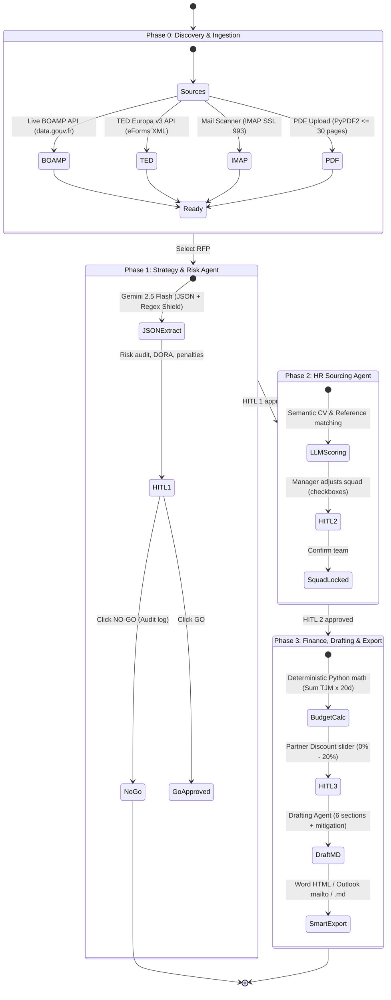
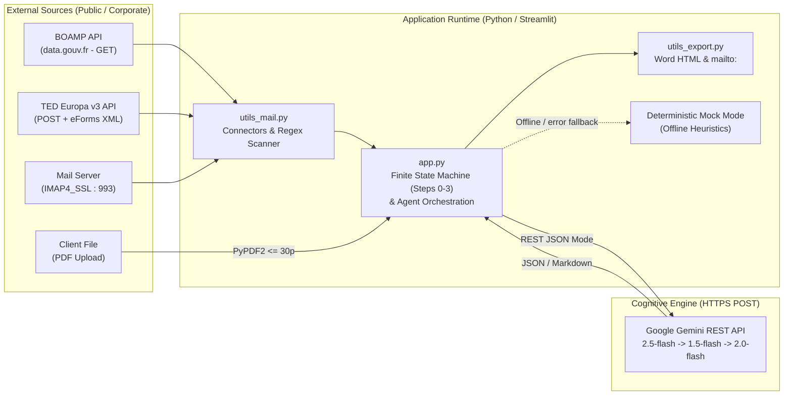

## The Challenge: 3h30 to Convince a Joint Big 4 & Cloud Jury

Hosted at Deloitte's headquarters in La Défense in partnership with **Google Cloud** under the theme *"AI creates possibilities, make them solutions"*, this hackathon brought together Data, AI, and Cloud engineering students for an intensive one-day immersion:

* **Morning (09:00 – 12:00):** Exchanges with Deloitte and Google Cloud teams, workshops on AI in consulting, rules briefing, and team formation.
* **Build Sprint (13:00 – 16:30):** Only **3h30** to scope a real business use case, design the architecture, ship a working prototype (~1,900 lines of Python across 3 decoupled modules, with only 3 external dependencies: `streamlit`, `PyPDF2`, `markdown`), and prepare the live demo.
* **Final Pitch (16:30 – 17:30):** Live defense in front of a mixed jury of Deloitte partners/consultants and Google Cloud experts.

**Strategic Constraint:** With such a tight window, training a custom model or over-engineering with heavy agentic frameworks was out of the question. The goal was to ship an **immediately usable tool**, aligned with Google's ecosystem (Gemini), resilient during live demos, and compliant with Big 4 governance standards.

---

## 1. The Problem: Moving Beyond "Internal ChatGPT"

Major consulting firms have already moved past basic conversational GenAI—internal tools (such as D-GPT or PairD) can already summarize documents or draft paragraphs.

Yet **the core operational bottleneck for consultants remains untouched: Bid Management / Request for Proposal (RFP) responses.**

* **Hidden financial cost:** Answering a complex 100+ page RFP typically mobilizes 3 consultants for 5 to 10 days of **non-billable work**. If the bid is lost, it is a pure write-off.
* **HR friction:** Proposals are often drafted on evenings and weekends alongside billable client work, driving burnout and turnover among juniors and managers.
* **The Governance Wall (*Trusted AI*):** Why not let an LLM generate the proposal end-to-end? Because a single hallucination on a daily rate (TJM), a fabricated client reference, or a missed penalty clause (e.g., DORA compliance, daily late fees) exposes the firm to unacceptable legal and financial liability.

**The Hackathon Question:** How do we move from a *passive conversational assistant* to a **workflow-driven multi-agent system** that industrializes RFP responses while guaranteeing explicit human sign-off on every critical decision?

---

## 2. The Solution: An "Anti-Chatbot" Finite State Machine with Human-in-the-Loop (HITL)

Rather than building another chat window, I architected a blocking **Finite State Machine** in Streamlit (`st.session_state['step']` from `0` to `3`).

The core principle is simple: **AI handles the heavy lifting (speed), while the pipeline pauses at 3 strict checkpoints requiring explicit human approval (safety & accountability).**

### Pipeline Overview & HITL Gates

### User Journey (Thomas, Manager at Deloitte)

| Phase | AI Agent Role (Automation) | Human Checkpoint (HITL) |
| :--- | :--- | :--- |
| **Phase 0: Discovery & Ingestion** | Aggregates live tenders via public APIs (BOAMP, TED Europa), corporate inbox (IMAP SSL), or PDF upload (capped at 30 pages). | Consultant selects the RFP dossier to qualify. |
| **Phase 1: Scoping & Risks** | **Strategy Agent (`llm_analyse_rfp`):** Structured JSON extraction of client, budget, timeline, required skills, technical/legal risks (penalties, DORA), and fit verdict. | **HITL 1 — Go / No-Go:** Two physical buttons. Clicking *No-Go* halts the chain and logs the refusal for the Risk Committee. |
| **Phase 2: HR Sourcing** | **HR Agent (`llm_scorer_sourcing`):** Dynamic semantic scoring of internal consultant CVs against Phase 1 skills, sorted descending, plus best client reference selection. | **HITL 2 — Squad Validation:** Manager can uncheck unavailable consultants; the budget recalculates live. |
| **Phase 3: Finance & Drafting** | **Finance & Drafting Agent (`llm_generer_propale`):** Deterministic budget math ($\sum \text{TJM} \times 20\text{ days}$) and 6-section proposal drafting including a dedicated mitigation plan for exact PDF risks. | **HITL 3 — Partner Arbitration:** Partner adjusts the strategic commercial discount (`0%` to `20%` slider), recalculating net total before final export (Word HTML, Outlook `mailto:`, Markdown). |

---

## 3. Technical Architecture & Data Contracts

The application uses an intentionally lean modular design (zero heavy agentic frameworks) to maximize readability, execution speed, and live-demo reliability:

### Inter-Agent Data Contracts

To prevent semantic drift between steps, each agent communicates through a **strict JSON contract** validated before state transitions:

* **Phase 1 (`llm_analyse_rfp`)** returns: `decision`, `confidence_score` (normalized integer), `client_name`, `client_budget_estimate`, `timeline`, `executive_summary`, `required_skills[]`, `technical_risks[]`, `business_risks[]`, `deloitte_fit_verdict`.
* **Phase 2 (`llm_scorer_sourcing`)** consumes `required_skills[]` + CV pool + firm references and returns: `scores` (`{cv_id: int}`), `best_reference_id`, `rationale`.
* **Phase 3 (`llm_generer_propale`)** receives exact Phase 1 risks, the validated Phase 2 squad, and **Python pre-computed financial totals** to generate a 6-section proposal (Executive Summary, 4-Sprint Agile Methodology, Specific Risk Mitigation Plan, Squad & Staffing, Gross/Discount/Net Budget Table, Client Reference).

---

## 4. Technical Challenges & Engineering Decisions

Under a 3h30 sprint constraint, every engineering decision targeted three priorities: **legal compliance**, **LLM output reliability**, and **"Demo-Proof" resilience**.

### A. Compliance-by-Design: Open Data APIs & Read-Only IMAP vs. Scraping
Scraping procurement portals was rejected for legal compliance (ToS, GDPR risk on buyer contact data, French Penal Code Art. 323-1) and technical fragility (CAPTCHAs, DOM drift).

* **Live BOAMP API (`data.gouv.fr`):** Keyless `GET` queries on `boamp-datadila.opendatasoft.com` (1.7M+ official notices) with ODSQL `search(objet, ...)` filtering sorted by `dateparution desc`.
* **TED Europa v3 API (EU Publications Office):** `POST /v3/notices/search` over a rolling 30-day window, followed by XML parsing of eForms notices (`<cbc:Name>`, `<cac:ProcurementProject>`, `<cbc:Description>`).
* **Read-Only IMAP Scanner:** `imaplib.IMAP4_SSL` on port `993` with **`readonly=True`** (never altering read flags on corporate mailboxes), multi-encoding MIME decoding, and **triple regex detection** (`REGEX_RFP_SUBJECT`, `REGEX_RFP_BODY`, `REGEX_RFP_ATTACHMENT`) assigning an 85% or 95% confidence pre-score.
* **Field Anecdote ("The Saint-Cloud Trap"):** During live BOAMP API testing, querying `"cloud"` consistently returned roadwork and municipal construction tenders for the French town of… **Saint-Cloud**. This real-world catch drove precise domain filtering: targeted IT keywords on BOAMP (`"système d'information"`, `"transformation numérique"`, `"cybersécurité"`, `"cloud computing"`) and strict **CPV code `72000000`** (IT Services) filtering on TED Europa.

### B. LLM Reliability, Multi-Model Cascade & Deterministic Finance
LLMs easily break UIs by wrapping JSON in conversational text or hallucinating budget arithmetic.

* **Zero-dependency REST client (`call_gemini_rest`):** Native Python `urllib.request` calling Google Gemini REST (`temperature: 0.2`, `maxOutputTokens: 3072`, 18s timeout)—eliminating SDK version conflicts during the sprint.
* **Multi-model resilience cascade:** Automatic failover across `gemini-2.5-flash` → `gemini-1.5-flash` → `gemini-2.0-flash` before falling back offline.
* **Dual JSON guard:** Native `"response_mime_type": "application/json"` paired with `parse_json_safely()` (`re.search(r'\{.*\}', raw_text, re.DOTALL)`) to isolate the JSON payload reliably.
* **Strict AI / Finance separation:** The LLM never computes prices. Python deterministically computes `base_budget = sum(TJM) * 20` and `final_budget = base_budget * (1 - discount_pct / 100)`, injecting exact figures as hard constraints into the drafting prompt.
* **Debiasing & context cap:** Removed hardcoded examples from system prompts and capped `PyPDF2` parsing at **30 pages** to prevent token/latency spikes.

### C. Modular Architecture, Zero-Setup Smart Export & Offline Fail-Safe
* **Clean separation of concerns:**
  * `app.py` (1,322 lines): State machine, 3-agent orchestration, fallbacks, and corporate UI (Deloitte `#86BC25`, embedded offline SVG logo, Material Symbols).
  * `utils_mail.py` (445 lines): BOAMP, TED Europa v3, IMAP SSL scanner, and demo dataset.
  * `utils_export.py` (150 lines): Zero-infrastructure exports — `get_html_download()` converts Markdown to self-contained Word-ready styled HTML, and `get_mailto_link()` builds an RFC 2368 `mailto:` URI opening a pre-filled Outlook draft without SMTP/OAuth setup.
* **Security & Fail-Safe:** Secrets loaded from `.env` (git-ignored). If the API key is missing or venue Wi-Fi drops, the app seamlessly switches to a **Deterministic Heuristic Mock Mode** without ever crashing on stage.

---

## 5. Business Impact & Value

1. **Productivity:** Cuts initial RFP qualification and first-draft proposal turnaround from **days to minutes**.
2. **Governance (*Trusted AI*):** Explicit auditability of human decisions (No-Go refusal logs, Manager availability sign-off, Partner-only discount control).
3. **Plug & Play Integration:** Fits directly into existing workflows (bid inbox, engagement committee, staffing, Microsoft 365 Word/Outlook).
4. **Consultant Experience:** Removes repetitive grunt work (parsing 100+ page specs, consolidating daily rates, hunting references) in favor of strategic analysis.

---

## 6. Current Limitations & Industrial V2 Roadmap

* **Persistence & Immutable Audit Trail:** Replace ephemeral `st.session_state` with PostgreSQL logging every timestamped `Go/No-Go`, squad edit, and Partner discount.
* **Authentication & RBAC (Microsoft Entra ID / SSO):** Enforce strict role separation between *Manager* (HITL 1 & 2) and *Partner* (HITL 3 discount slider).
* **RAG over Firm Intellectual Capital (SharePoint / Staffing ERP):** Replace simulated JSON pools with vector search over anonymized past deliverables and live HR availability.
* **Enterprise Connectors (Microsoft Graph API & CRM):** Replace IMAP polling with Microsoft Graph webhooks and auto-sync `Go` bids to Salesforce / SAP CRM.
* **Native `.docx` / `.pptx` Export:** Inject generated sections directly into official corporate templates via `python-docx` / `python-pptx`.

---

## 7. Key Takeaways

* **UX & governance beat model complexity:** No fine-tuning or bloated agent frameworks were needed—finite-state orchestration, blocking HITL gates, and deterministic financial math won the jury's attention.
* **Real-world data is always messy:** The "Saint-Cloud" BOAMP catch reinforces that an AI/Data pipeline is only as strong as its upstream domain filtering.
* **Build "Enterprise-First" even in 3h30:** Security (`.env`, `readonly=True` IMAP), compliance (official APIs over scraping), and resilience (model cascade + offline fallback) turn a sprint prototype into a credible executive tool.
