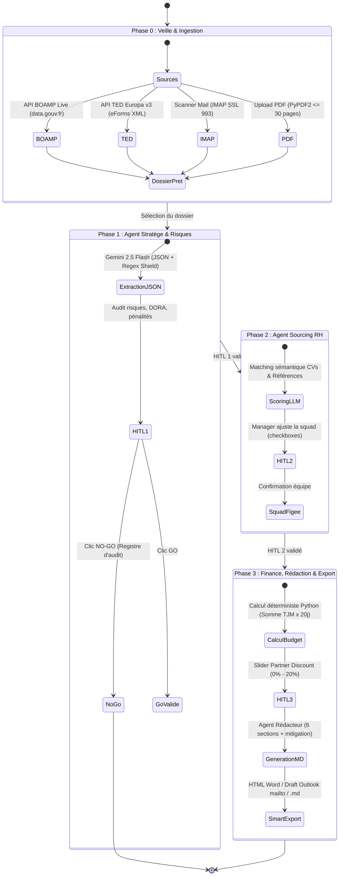
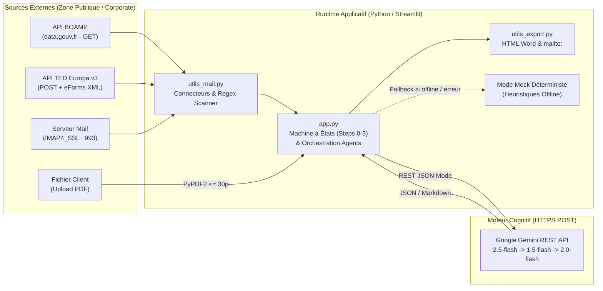

## Le Cadre du Défi : 3h30 pour convaincre un double jury

Organisé dans les locaux de Deloitte à La Défense en partenariat avec **Google Cloud** autour du thème *« L'IA crée des possibilités, à vous d'en faire des solutions »*, ce hackathon réunissait des étudiants spécialisés en Data, IA et Cloud pour une journée d'immersion intense :

* **Matinée (09h00 – 12h00) :** Échanges avec les équipes Deloitte et Google Cloud, ateliers sur l'IA au cœur des métiers du conseil, briefing des règles et constitution des équipes.
* **Sprint de développement (13h00 – 16h30) :** Seulement **3h30** pour cadrer un cas d'usage métier réel, concevoir l'architecture, développer un prototype fonctionnel (~1 900 lignes de Python en 3 modules découplés, avec seulement 3 dépendances externes : `streamlit`, `PyPDF2`, `markdown`) et préparer la démonstration.
* **Pitch final (16h30 – 17h30) :** Soutenance en direct face à un jury mixte (associés/consultants Deloitte et experts Google Cloud).

**L'enjeu stratégique :** Avec une fenêtre de tir aussi courte, il était hors de question d'entraîner un modèle ou de sur-ingénierer l'infrastructure avec des frameworks lourds. L'objectif était de livrer un **outil exploitable immédiatement**, aligné sur l'écosystème Google (Gemini), résilient en démo live et répondant aux exigences strictes de gouvernance d'un cabinet du Big 4.

---

## 1. Le Constat : Au-delà du « ChatGPT interne »

En analysant les publications stratégiques et les axes d'investissement de Deloitte (notamment autour de la *Trusted AI* et de l'*Agentic AI*), un constat s'impose : les grands cabinets de conseil ont déjà dépassé le stade de l'IA générative conversationnelle. Ils disposent d'outils internes sécurisés (comme D-GPT ou PairD) capables de résumer un texte ou de rédiger un paragraphe.

Pourtant, **le véritable goulot d'étranglement des consultants reste intact : la gestion des Appels d'Offres (Bid Management / RFP).**

* **Un coût financier caché :** Répondre à un appel d'offres complexe (100+ pages) mobilise typiquement 3 consultants pendant 5 à 10 jours de travail **non facturable**. Si l'appel d'offres est perdu, c'est une perte sèche pour le cabinet.
* **Un point de friction RH :** Les « propales » se rédigent souvent le soir et le week-end, en parallèle des missions facturées, ce qui alimente l'épuisement et le turnover des juniors et managers.
* **Le mur de la gouvernance (*Trusted AI*) :** Pourquoi ne pas simplement demander à un LLM de générer la proposition commerciale de bout en bout ? Parce qu'une hallucination sur un TJM (Taux Journalier Moyen), une fausse référence client ou une clause de pénalité ignorée (ex. conformité DORA, pénalités journalières) expose le cabinet à un risque juridique et financier inacceptable.

**La problématique du Hackathon :** Comment passer d'un *assistant conversationnel passif* à un **système multi-agents orienté workflow**, capable d'industrialiser la réponse aux appels d'offres tout en garantissant un contrôle humain absolu sur chaque décision critique ?

---

## 2. La Solution : Une Architecture « Anti-Chatbot » centrée sur le Human-in-the-Loop (HITL)

Plutôt que de concevoir une énième fenêtre de chat, j'ai architecturé une **Machine à États Finis (Finite State Machine)** bloquante sous Streamlit (`st.session_state['step']` de `0` à `3`).

Le principe directeur est simple : **l'IA abat le travail de fond (vitesse), mais le pipeline se met en pause à 3 points de contrôle stricts pour exiger une validation humaine explicite (sécurité & responsabilité).**

### Vue d'ensemble du Pipeline & des Jalons HITL

### Le parcours utilisateur (L'histoire de Thomas, Manager chez Deloitte)

| Phase | Rôle de l'Agent IA (Automatisation) | Point de Contrôle Humain (HITL) |
| :--- | :--- | :--- |
| **Phase 0 : Veille & Ingestion** | Agrégation d'appels d'offres réels via APIs publiques (BOAMP, TED Europa), boîte mail (IMAP SSL) ou dépôt PDF (plafonné à 30 pages). | Le consultant sélectionne le dossier à qualifier. |
| **Phase 1 : Cadrage & Risques** | **Agent Stratège (`llm_analyse_rfp`) :** Extraction JSON structurée du client, budget, délais, compétences clés, risques techniques/juridiques (pénalités, DORA) et verdict d'alignement. | **HITL 1 — Go / No-Go :** Deux boutons physiques. Un clic sur *No-Go* stoppe la chaîne et consigne le refus pour le Comité des Risques. |
| **Phase 2 : Sourcing RH** | **Agent RH (`llm_scorer_sourcing`) :** Scoring sémantique dynamique des consultants internes face aux compétences extraites en Phase 1. Tri décroissant et sélection de la référence client la plus pertinente. | **HITL 2 — Validation Squad :** Le manager peut décocher un consultant (ex. en formation ou indisponible). Le budget se recalcule en direct. |
| **Phase 3 : Finance & Rédaction** | **Agent Rédacteur & Finance (`llm_generer_propale`) :** Calcul déterministe du budget ($\sum \text{TJM} \times 20\text{ jours}$), rédaction en 6 sections incluant un plan dédié à la mitigation des risques réels extraits du PDF. | **HITL 3 — Arbitrage Partner :** L'Associé ajuste une remise commerciale stratégique (slider `0%` à `20%`) recalculant le net avant l'export final (HTML Word, brouillon Outlook `mailto:`, Markdown). |

---

## 3. Architecture Technique & Contrats de Données

L'application repose sur une architecture modulaire volontairement épurée (zéro framework agentique lourd) pour maximiser la lisibilité, la vitesse d'exécution et la maintenabilité :

### Contrats de données entre agents

Pour éviter la dérive sémantique entre étapes, chaque agent communique via un **contrat JSON strict** vérifié avant transition d'état :

* **Phase 1 (`llm_analyse_rfp`)** retourne un objet structuré : `decision`, `confidence_score` (normalisé en entier), `client_name`, `client_budget_estimate`, `timeline`, `executive_summary`, `required_skills[]`, `technical_risks[]`, `business_risks[]`, `deloitte_fit_verdict`.
* **Phase 2 (`llm_scorer_sourcing`)** consomme `required_skills[]` + le vivier de CVs + les références cabinet et retourne : `scores` (`{cv_id: int}`), `best_reference_id`, `rationale`.
* **Phase 3 (`llm_generer_propale`)** reçoit les risques exacts de Phase 1, la squad validée de Phase 2 et les **montants financiers pré-calculés en Python** pour produire une proposition structurée en 6 sections (Synthèse exécutive, Méthodologie Agile 4 sprints, Plan de maîtrise des risques spécifiques, Squad & Staffing, Tableau budgétaire brut/remise/net, Référence client).

---

## 4. Défis Techniques & Choix d'Ingénierie

Dans le cadre contraint d'un sprint de 3h30, chaque décision d'ingénierie visait trois objectifs : **conformité légale**, **fiabilité des sorties LLM** et **résilience « Demo-Proof »** (zéro crash en direct).

### A. Compliance-by-Design : APIs Open Data & IMAP Read-Only vs Scraping
Pour alimenter l'outil avec de vrais appels d'offres, la tentation initiale était de scraper des plateformes de marchés publics. Cette approche a été écartée pour des raisons de conformité légale (CGU, risque RGPD sur la collecte de coordonnées d'acheteurs, art. 323-1 du Code Pénal) et de fragilité technique (CAPTCHA, changements DOM).

* **API BOAMP Live (`data.gouv.fr`) :** Requêtes `GET` sans clé sur `boamp-datadila.opendatasoft.com` (1,7M+ avis officiels), filtrage ODSQL `search(objet, ...)` trié par `dateparution desc` et pagination dynamique.
* **API TED Europa v3 (Publications Office EU) :** Requêtes `POST /v3/notices/search` sur une fenêtre glissante de 30 jours, suivies de la récupération et du parsing XML des avis eForms (`<cbc:Name>`, `<cac:ProcurementProject>`, `<cbc:Description>`).
* **Scanner IMAP Sécurisé :** Connexion `imaplib.IMAP4_SSL` sur le port `993` en mode **`readonly=True`** (aucune modification des statuts de lecture sur la boîte corporate), décodage MIME multi-encodages et **triple détection regex** (`REGEX_RFP_SUBJECT`, `REGEX_RFP_BODY`, `REGEX_RFP_ATTACHMENT`) attribuant un pré-score de confiance (85 % ou 95 %).
* **L'anecdote terrain (« Le piège de Saint-Cloud ») :** Lors des premiers tests en live sur l'API BOAMP, la recherche sur le mot-clé `"cloud"` remontait systématiquement des marchés de voirie et de travaux publics de la commune de… **Saint-Cloud**. Ce test réel a conduit à affiner le filtrage métier : utilisation de mots-clés IT précis sur le BOAMP (`"système d'information"`, `"transformation numérique"`, `"cybersécurité"`, `"cloud computing"`) et filtrage strict par **code CPV officiel `72000000`** (Services IT) sur TED Europa.

### B. Fiabilisation des appels LLM, Cascade Multi-Modèles & Déterminisme Financier
Un LLM peut facilement casser une interface en ajoutant du texte conversationnel avant un bloc JSON (ex. *"Voici votre analyse : {...}"*) ou en hallucinant une somme budgétaire.

* **Client REST zéro-dépendance (`call_gemini_rest`) :** Utilisation de `urllib.request` en Python natif pour interroger l'API Google Gemini (`temperature: 0.2`, `maxOutputTokens: 3072`, timeout 18s), évitant tout conflit de version de SDK pendant le sprint.
* **Cascade de résilience multi-modèles :** En cas d'indisponibilité ou de saturation de quota, le client bascule automatiquement sur la chaîne `gemini-2.5-flash` → `gemini-1.5-flash` → `gemini-2.0-flash` avant de déclencher le fallback offline.
* **Double sécurité JSON :** Activation du mode natif `"response_mime_type": "application/json"` dans `generationConfig`, couplée à une fonction `parse_json_safely()` basée sur une expression régulière (`re.search(r'\{.*\}', raw_text, re.DOTALL)`) pour isoler le payload JSON quoi qu'il arrive.
* **Séparation stricte IA / Calcul financier :** Le LLM ne calcule jamais le prix. Python calcule de manière déterministe `base_budget = sum(TJM) * 20` et `final_budget = base_budget * (1 - discount_pct / 100)`, puis injecte ces chiffres exacts comme contraintes impératives dans le prompt de rédaction.
* **Dé-biaisage & Garde-fou de contexte :** Suppression de tout exemple « en dur » dans les prompts système pour garantir une extraction fidèle au document fourni, et plafonnement du parser `PyPDF2` à **30 pages maximum** pour éviter l'explosion de tokens / latence.

### C. Architecture Modulaire, Smart Export « Zero-Setup » & Mode Offline
* **Séparation claire des responsabilités :**
  * `app.py` (1 322 lignes) : Machine à états, orchestration des 3 agents, gestion des fallbacks et UI corporate (charte Deloitte `#86BC25`, logo SVG vectoriel embarqué pour fonctionner 100 % offline, Material Symbols).
  * `utils_mail.py` (445 lignes) : Connecteurs BOAMP, TED Europa v3, scanner IMAP SSL et jeu de données de démonstration.
  * `utils_export.py` (150 lignes) : Export prêt à l'emploi sans infrastructure additionnelle :
    * `get_html_download()` convertit la proposition Markdown en HTML auto-portant stylé Deloitte (`tables`, `fenced_code`) pour un copier-coller natif et propre dans Microsoft Word.
    * `get_mailto_link()` génère une URI `mailto:` encodée (RFC 2368 via `urllib.parse.quote`) ouvrant directement un brouillon pré-rempli dans Outlook sans configuration SMTP/OAuth.
* **Sécurité & Fail-Safe :** Chargement des secrets (`GEMINI_API_KEY`, `IMAP_*`) depuis `.env` (exclu de Git via `.gitignore`). Si la clé est absente ou si le Wi-Fi de la salle coupe, l'application bascule de manière transparente en **Mode Mock Heuristique** (scores calculés dynamiquement sur le texte du RFP + latence simulée) sans jamais planter devant le jury.

---

## 5. Impact Métier & Valeur Ajoutée

Ce prototype démontre comment l'IA Agentique peut transformer un processus cœur de métier sans sacrifier la maîtrise des risques :

1. **Productivité :** Réduction estimée du temps de qualification et de rédaction d'une première version de propale de **plusieurs jours à quelques minutes**.
2. **Gouvernance (*Trusted AI*) :** Traçabilité explicite des décisions humaines (audit de refus en cas de *No-Go*, validation de la disponibilité réelle par le Manager, contrôle exclusif de la remise commerciale par le Partner).
3. **Intégration « Plug & Play » :** Alignement direct sur les outils existants (boîte consultation, comité d'engagement, staffing, suite Microsoft 365 Word/Outlook).
4. **Expérience Collaborateur :** Suppression des tâches répétitives (lecture brute de cahiers des charges de 100+ pages, consolidation de TJM, recherche de références) au profit de l'analyse stratégique.

---

## 6. Limites Actuelles & Roadmap (V2 Industrielle)

Dans une optique de mise en production réelle au sein d'un cabinet comme Deloitte, les chantiers d'industrialisation identifiés sont :

* **Persistance & Piste d'Audit Immuable :** Remplacer l'état éphémère en mémoire (`st.session_state`) par une base relationnelle (PostgreSQL) journalisant chaque décision `Go/No-Go`, modification de squad et remise Partner avec horodatage.
* **Authentification & RBAC (Microsoft Entra ID / SSO) :** Séparer réellement les permissions entre le *Manager* (HITL 1 & 2) et le *Partner* (seul habilité à actionner le slider de remise commerciale en HITL 3).
* **RAG sur le Capital Intellectuel (SharePoint / ERP Staffing) :** Remplacer les bases JSON simulées de CVs et de références par une recherche vectorielle indexant les anciens livrables anonymisés et les disponibilités temps réel de l'ERP RH, ainsi qu'un pré-scoring sémantique dès la Phase 0.
* **Connecteurs Entreprise (Microsoft Graph API & CRM) :** Remplacer le polling IMAP par des webhooks Microsoft Graph sur la boîte dédiée (`rfp-agent@deloitte.com`) et synchroniser automatiquement les dossiers `Go` vers Salesforce / SAP CRM.
* **Export natif `.docx` / `.pptx` :** Injecter directement le contenu généré dans les templates Word et PowerPoint officiels du cabinet via `python-docx` / `python-pptx`.

---

## 7. Ce que ce projet m'a appris

* **L'UX et la gouvernance priment sur la complexité du modèle :** Il n'a pas été nécessaire de fine-tuner un modèle ni d'empiler des frameworks agentiques pour créer de la valeur. L'orchestration en machine à états, les jalons bloquants HITL et le calcul financier déterministe ont fait toute la différence face au jury.
* **La donnée réelle est toujours imprévisible :** L'épisode « Saint-Cloud » sur l'API BOAMP rappelle qu'un pipeline IA/Data ne vaut que par la qualité de son filtrage métier en amont.
* **Penser « Entreprise » dès le prototype :** Intégrer la sécurité (`.env`, IMAP `readonly=True`), la conformité (APIs officielles vs scraping) et la résilience (cascade de modèles + fallback offline) transforme un prototype de 3h30 en un outil crédible face à des décideurs métier.
